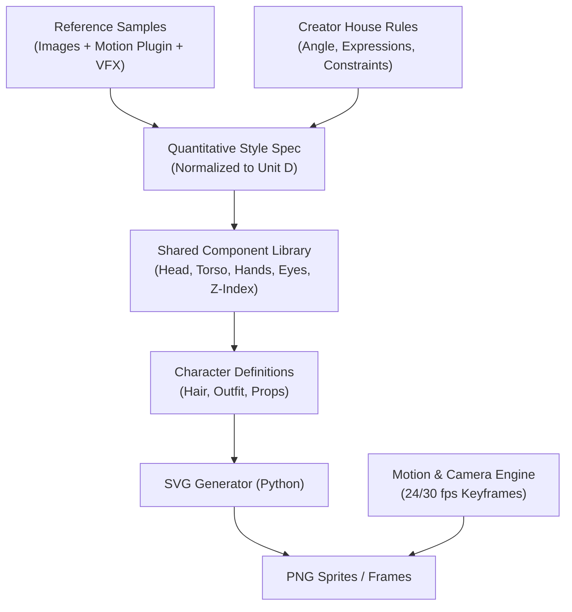

# Code-Driven 2D Asset Pipeline

A **Code-Driven 2D Asset Pipeline** replaces manual drawing and unpredictable raster AI image generation with an LLM-built **programmatic drawing machine** (e.g., Python scripts generating [[svg|SVG]] and exporting PNG sprites/frames). Instead of asking an AI to "paint" each frame directly, the AI writes modular, parameterized code governed by measured style rules.

## Why It Matters for Indie Game Development
- **100% Style & Proportion Consistency**: Characters share the exact same stroke weight, palette, and head-to-body ratio across every pose, expression, and newly added NPC.
- **Instant Global Updates**: Because shared anatomy (head, torso, hands, weapons, expressions) lives in reusable functions, fixing a layering bug (`z-index`) or simplifying hand shapes updates the entire cast simultaneously.
- **Expression & Variant Scaling**: Generating 6+ facial expressions (neutral, happy, angry, sad, surprised, scared) or new characters becomes a matter of swapping modular hair, outfits, props, and eye/brow parameters.
- **Frame-Accurate Animation**: Motion cycles (walk bounce, nod, hit-shake, camera shake) are deterministic math at 24/30 fps rather than AI-hallucinated in-betweens.

## Architecture

## Key Failure Modes & Mitigations
1. **Detail Bloat from Vague Prompts**: Asking to "improve" a part often causes the AI to add complex, off-style details (e.g., jointed fingers on a minimalist rig). *Mitigation*: Always critique with tightly cropped reference images.
2. **Layer Occlusion (`z-index`)**: Weapons or impact VFX can cover hands or bodies during action frames. *Mitigation*: Enforce explicit layer ordering (`body -> VFX -> hand -> text`) in shared render functions and render peak-impact frames for inspection.
3. **Cross-Cut Continuity Bugs**: Characters may snap back to default coordinates between animation beats, which per-segment unit tests miss. *Mitigation*: Always review the full rendered sequence with human eyes.

## References
- [[claude-2d-character-animation-workflow]]
- Related: [[quantitative-style-measurement]], [[skill-driven-agent-workflows]], [[svg]], [[claude-code]]
