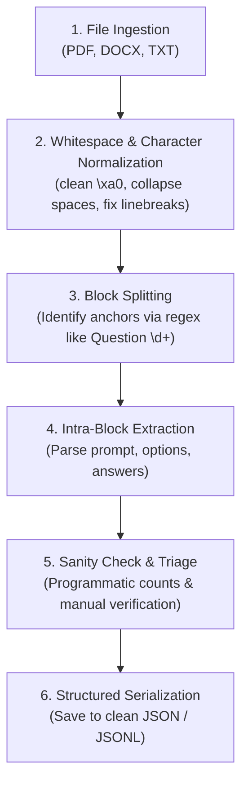

# Data Cleaning Guide for Unstructured Text

This guide defines an end-to-end extraction and normalization pipeline for converting unstructured or semi-structured raw documents (such as exported DOCX, PDF, or text dumps) into clean, machine-readable datasets (e.g., JSON/JSONL).



## 5-Stage Cleaning Pipeline

### 1. Ingestion
Load raw file streams into Python using appropriate parsing engines (e.g., `pypdf`, `pdfplumber`, or `python-docx`). Ensure characters are decoded into UTF-8.

### 2. Normalization & Sanitization
Raw extracts frequently contain non-standard Unicode artifacts and inconsistent formatting:
- **Clean Invisible / Non-Breaking Spaces**: Replace `\xa0` (non-breaking space) and `\u200b` (zero-width space) with standard whitespace or strip them out.
- **Collapse Redundant Whitespace**: Standardize variable runs of spaces and tabs into single spaces using `re.sub(r"[ \t]+", " ", text)`.
- **Repair Segmented Line Breaks**: Merge broken lines that occur mid-sentence while preserving deliberate paragraph breaks.

### 3. Block Splitting via Structural Anchors
Identify recurring delimiters that mark the start of independent records (e.g., `"Question \d+"`, `"Câu \d+"`, or numeric bullets). Use lookaheads to split the document into distinct item blocks without losing headers:
```python
import re
blocks = re.split(r"(?m)(?=^(?:Question|Câu)\s+\d+)", raw_text)
```

### 4. Intra-Block Extraction
Within each isolated block, parse discrete data fields using targeted regular expressions and pattern matching:
- Extract questions by locating the prompt boundary before choice markers.
- Extract multiple-choice options by scanning for bullet markers (e.g., `[A-D]\.`).
- Extract answer keys or rationale blocks.

### 5. Sanity Checking & Validation
Run automated validation checks across parsed objects:
- Verify that question IDs form a continuous, non-duplicated sequence.
- Check that all blocks yielded both a question body and expected options.
- Flag parsing anomalies for manual inspection and correction before final export.

### 6. Serialization
Serialize validated records into structured JSON or JSONL format for downstream NLP tasks, databases, or fine-tuning datasets.

## Regex Toolkit
Regular expression compilation flags are critical for robust document processing. See [[regex-flags-reference]] for detailed flag definitions:
- Multi-line matching (`(?m)`): anchors `^` and `$` to each line boundary.
- Dot-all mode (`(?s)`): permits `.` to span across newline characters.
- Case-insensitivity (`(?i)`): guarantees uniform keyword capture.
- String termination (`\Z`): matches strictly at the end of the input buffer.

## References
- See also: [[regex-flags-reference]]
