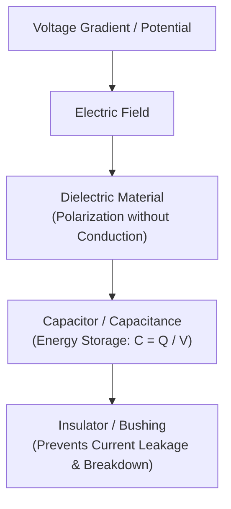

# Electrical Engineering and Electromagnetism Glossary

This glossary consolidates foundational terminology, physical principles, and component definitions within electrical engineering, circuit analysis, and electrostatic physics.

## Consolidated Terms

### 1. Bushing
- **Part of Speech**: Noun
- **Vietnamese Equivalent**: *Ống lót cách điện / Sứ xuyên*
- **Definition**: An insulating lining or sleeve-like component that permits an energized electrical conductor to safely pass through a grounded barrier (such as a transformer casing, switchgear wall, or circuit breaker frame) without causing electrical flashover or short-circuiting.

### 2. Capacitance
- **Part of Speech**: Noun
- **Symbol / Unit**: $C$, measured in Farads ($\text{F}$)
- **Vietnamese Equivalent**: *Điện dung*
- **Definition**: The quantitative measure of an electric system's or component's capacity to store electrostatic charge per unit electrical potential difference:
  $$C = \frac{Q}{V}$$
  For an ideal parallel-plate capacitor with plate area $A$, separation distance $d$, and permittivity $\varepsilon$:
  $$C = \frac{\varepsilon A}{d}$$

### 3. Capacitor
- **Part of Speech**: Noun
- **Vietnamese Equivalent**: *Tụ điện*
- **Definition**: A passive two-terminal electronic component designed to store energy electrostatically in an internal electric field. It consists of two conducting plates separated by an insulating or [[#4. Dielectric|dielectric]] material.

### 4. Dielectric
- **Part of Speech**: Adjective / Noun
- **Vietnamese Equivalent**: *Chất điện môi*
- **Definition**: An electrical insulating material that can be polarized by an externally applied electric field. When placed between capacitor electrodes, dielectric dipoles align with the field, reducing the internal field intensity and allowing greater charge storage at a given voltage (increasing effective capacitance by dielectric constant $\kappa$ or relative permittivity $\varepsilon_r$).

### 5. Equipotential
- **Part of Speech**: Adjective
- **Vietnamese Equivalent**: *Đẳng thế*
- **Definition**: Pertaining to a region, surface, or line across which the electric potential $V$ remains strictly uniform and constant ($V(\mathbf{r}) = \text{const}$).
  - No work is performed by or against the electrostatic field when moving a charge along an equipotential path ($W = q\Delta V = 0$).
  - Electric field lines always intersect equipotential surfaces at right angles ($90^\circ$, see [[academic-english-vocabulary|perpendicular and orthogonal]]).

### 6. Insulate
- **Part of Speech**: Verb
- **Vietnamese Equivalent**: *Cách điện / Cách nhiệt*
- **Definition**: To protect, separate, or enclose an object with a non-conducting material in order to prevent or significantly retard the transfer of electric current, thermal heat, or sound.

### 7. Insulator
- **Part of Speech**: Noun
- **Vietnamese Equivalent**: *Vật liệu cách điện*
- **Definition**: A material possessing very high electrical resistivity and a wide electronic band gap, preventing the free flow of electric charge carriers (electrons) under normal operational electric fields. Common electrical insulators include ceramics, glass, mica, and specialized polymers.

## Summary Table

| Term | POS | Core Electrical Role | Vietnamese Translation |
| :--- | :--- | :--- | :--- |
| **Bushing** | Noun | High-voltage conductor sleeve through grounded walls | Ống lót / Sứ xuyên |
| **Capacitance** | Noun | Charge storage ratio ($C = Q/V$) | Điện dung |
| **Capacitor** | Noun | Passive electrostatic energy storage device | Tụ điện |
| **Dielectric** | Adj/Noun | Polarizable non-conducting medium | Chất điện môi |
| **Equipotential**| Adj | Constant electric potential boundary | Đẳng thế |
| **Insulate** | Verb | Process of blocking electrical/thermal transfer | Cách điện / Cách nhiệt |
| **Insulator** | Noun | Material with negligible charge conductivity | Vật liệu cách điện |

## References
- Geometric and mathematical terminology: [[academic-english-vocabulary]]
