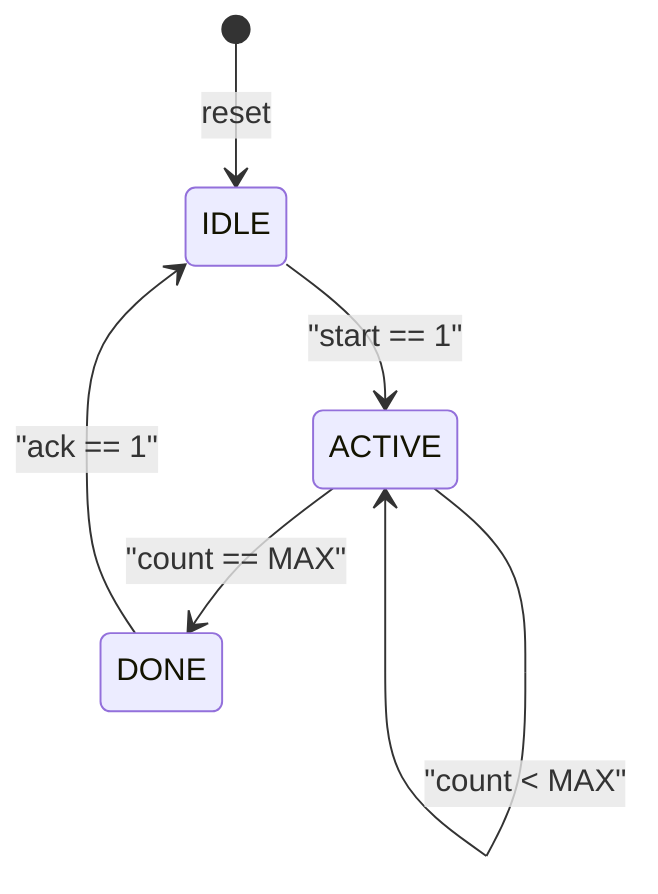

# Finite State Machine (FSM)

A **Finite State Machine (FSM)** is a digital sequential model combining **combinational logic** and **sequential memory elements** to decompose a complex control problem into a finite set of discrete states.

---

## 1. Core Structure of an FSM

An FSM consists of three fundamental components:
1. **$k$ States:** A finite set of discrete operating conditions stored in state registers (flip-flops).
2. **Transition Rules (Next-State Logic):** Combinational logic determining the next state from the current state and external inputs.
3. **Output Rules (Output Logic):** Combinational logic generating outputs based on the current state (and optionally the inputs).

---

## 2. Mealy vs. Moore Machine Models

| Style | Output Function | Characteristics |
|---|---|---|
| **Moore Machine** | $\text{Output} = f(\text{current state})$ | Outputs depend **only** on the current state; synchronous with state transitions and immune to input glitches. |
| **Mealy Machine** | $\text{Output} = f(\text{input}, \text{current state})$ | Outputs depend on **both** the current state and current inputs; can react immediately within the same clock cycle and often requires fewer states. |

---

## 3. State Transition Graph (STG) Example

A **State Transition Graph (STG)** visualizes states as nodes and transition rules as directed edges labeled with input conditions (and outputs for Mealy machines). Below is a simple 3-state sequence/traffic controller example using a Moore-style `stateDiagram-v2`:

---

## 4. State Encoding

To implement the $k$ abstract states in hardware flip-flops, each state is assigned a binary code:
- **Binary (Sequential) Encoding:** Uses $\lceil \log_2 k \rceil$ flip-flops (minimum register count).
- **One-Hot Encoding:** Uses $k$ flip-flops, with exactly one bit set to `1` per state (simplifies next-state and output decoding logic in FPGAs).
- **Gray Encoding:** Adjacent states differ by only 1 bit, minimizing simultaneous bit transitions.

---

## Related Notes
- [[hdl-behavioral-modeling-and-testbenches]]
