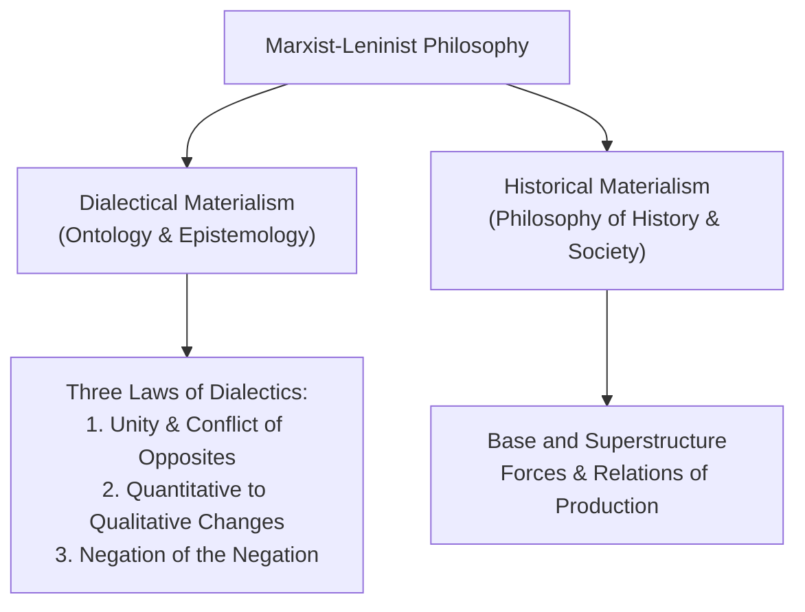

# Marxist-Leninist Philosophy: Foundations and Core Principles

**Marxist-Leninist Philosophy** is a philosophical and socio-scientific system established by Karl Marx and Friedrich Engels, and systematically developed by Vladimir Lenin. It provides a materialist worldview and dialectical methodology for comprehending nature, human society, and the laws governing human thought.

## 1. Dialectical Materialism

Dialectical materialism represents the integration of philosophical materialism with dialectical reasoning:

- **Materialist Ontology**: Matter is an objective reality existing outside and independent of human consciousness. Consciousness is a reflection of the material world and a specialized property of highly organized matter (the human brain).
- **The Core Dialectical Laws**:
  1. **The Law of the Unity and Conflict of Opposites**: Every entity and phenomenon contains internal contradictions. The interaction and struggle between opposing tendencies within an object serve as the fundamental driving force of motion, evolution, and development.
  2. **The Law of the Transformation of Quantitative Changes into Qualitative Changes**: Gradual, incremental quantitative changes accumulate until reaching a critical boundary (the measure / *nodal point*), precipitating a sudden qualitative leap into a fundamentally new state.
  3. **The Law of the Negation of the Negation**: Development proceeds through successive stages of dialectical negation. Each new stage preserves the positive achievements of prior stages while overcoming their limitations, resulting in a progressive ascending spiral rather than a linear or circular cycle.

## 2. Historical Materialism

Historical materialism applies dialectical materialist principles to the analysis of human society and historical development:

- **The Mode of Production**: The material production of life is the foundation of social existence. It comprises:
  - **Productive Forces**: Instruments of labor, technology, raw resources, and human labor capability.
  - **Relations of Production**: Socio-economic relationships formed in the process of production, distribution, exchange, and consumption (principally ownership of the means of production).
- **Base and Superstructure**:
  - **The Economic Base**: The totality of production relations corresponding to a given stage of productive forces.
  - **The Superstructure**: The political, legal, religious, philosophical, and institutional forms established upon the economic base, along with corresponding social consciousness. While the base determines the superstructure, the superstructure exerts reciprocal active influence upon the base.
- **Socio-Economic Formations**: Human history progresses through distinct socio-economic formations (primitive communal, slave-owning, feudal, capitalist, and communist/socialist) driven by contradictions between advancing productive forces and obsolete relations of production.

## 3. Epistemology (Theory of Knowledge)

- **Practice as the Criterion of Truth**: Knowledge arises from, is guided by, and is validated through social practice (production, scientific experimentation, and social transformation).
- Truth is objective, concrete, and develops from relative truth toward absolute truth through iterative inquiry.

## References
- Source Subject: Introduction to Marxist-Leninist Philosophy and Political Economy.
