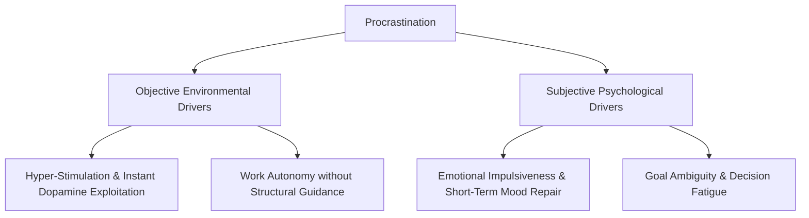

# Overcoming Procrastination: Causes and Systems

**Procrastination** is the voluntary, irrational delay of an intended action despite knowing that the delay will likely lead to worse outcomes, heightened stress, and diminished performance. It is fundamentally an issue of emotional regulation and goal architecture rather than mere laziness.

## Root Causes of Procrastination

### 1. Objective Drivers
- **Hyper-Stimulant Environments**: Ubiquitous digital entertainment and social platforms provide instant, effortless dopamine rewards, making high-effort cognitive tasks appear comparatively punitive to the brain's reward circuitry.
- **Ambiguous Work Autonomy**: Modern work environments prioritize autonomy and self-direction. Without clear external constraints and deadlines, individuals face mounting pressure and executive paralysis.

### 2. Subjective Drivers
- **Emotional Impulsiveness & Mood Repair**: When faced with a challenging, boring, or anxiety-inducing task, the brain seeks immediate relief. Delaying the task serves as a short-term coping mechanism to repair present mood at the expense of future well-being.
- **Goal Management Failure**: Abstract, oversized objectives lack immediate activation energy, leaving individuals unsure of the first concrete physical step.

## Chronic Consequences
- Deterioration in final work quality due to hurried last-minute execution.
- Persistent cognitive burden, guilt, and decision anxiety.
- Sleep disturbances and physical fatigue stemming from chronic avoidance stress.

## Actionable Resolution Systems

### 1. Emotional Regulation & Activation Thresholds
- **The Two-Minute Rule**: Lower the barrier to initiation. Commit to working on the task for merely two minutes. Overcoming the initial friction of starting often activates flow and bypasses avoidance reflexes.
- **"Eat That Frog" Strategy (Brian Tracy)**: Tackle your most difficult, intimidating, and high-impact task ("the frog") first thing in the morning when mental energy and executive willpower are at peak capacity.

### 2. Goal Architecture: The ABCDE Prioritization Method
Organize daily commitments into explicit hierarchical tiers to eliminate decision ambiguity:
- **A-Tier ("Must Do")**: High-consequence core priorities (Daily Highlights). Non-negotiable tasks whose neglect causes major negative repercussions. (Recommended limit: 1–3 items daily; absolute maximum: 5–10).
- **B-Tier ("Should Do")**: Secondary responsibilities with minor consequences.
- **C-Tier ("Nice to Do")**: Tasks with no tangible consequences if left undone.
- **D-Tier ("Delegate")**: Tasks that can be outsourced or automated to protect focus.
- **E-Tier ("Eliminate")**: Habitual, low-value activities to eradicate entirely.

## References & Related Thinking
- Self-awareness and strength identification: [[strengths-and-weaknesses-reflection]]
- Core habit mindset: [[five-rings-of-discipline]]
- Literature: Brian Tracy, *Eat That Frog!*; Mạnh Hải, *Khoa học về trì hoãn*.
