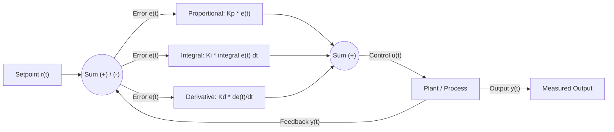

# Proportional–Integral–Derivative (PID) Controller

A **PID controller** is a closed-loop feedback control mechanism that continuously computes an error value $e(t) = r(t) - y(t)$ (the difference between a desired setpoint $r(t)$ and a measured process variable $y(t)$) and applies a correction based on three terms: **Proportional**, **Integral**, and **Derivative**.

---

## 1. Intuition Behind the Three Terms

- **Proportional (P — Present Error):**
  Reacts to how far the system currently is from the target setpoint, scaling the present error by a proportional gain $K_p$. Larger $K_p$ gives faster response, but excessive $K_p$ causes overshoot and oscillation.
- **Integral (I — Past Error):**
  Accumulates the error over time from the past until the present, scaling it by an integral gain $K_i$. If the system has not yet reached the setpoint (steady-state error), the integral term builds up to push the output faster toward the target.
- **Derivative (D — Future Error):**
  Estimates the future trend of the error from its rate of change, scaling it by a derivative gain $K_d$. If the system is approaching the target too rapidly and is about to overshoot, the derivative term applies damping to slow it down.

---

## 2. Standard Control Equation

In continuous time, the controller output $u(t)$ is:
$$u(t) = K_p e(t) + K_i \int_0^t e(\tau)\,d\tau + K_d \frac{de(t)}{dt}$$

---

## 3. Closed-Loop Control Diagram

---

## Related Notes
- [[electrical-circuit-fundamentals]]
