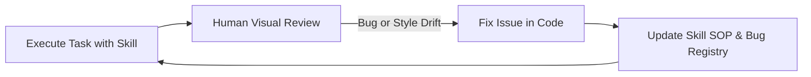

# Skill-Driven Agent Workflows

A **Skill** is a structured folder (typically containing `SKILL.md`, reference docs, and helper scripts/assets) that turns a multi-step, trial-and-error AI workflow into a repeatable, on-demand capability.

## Four Core Components of an Effective Skill
1. **Trigger Description (Frontmatter)**: Concise metadata ("book spine") telling the agent *what* the skill does and *when* to activate it automatically or via a `/slash-command`.
2. **Standard Operating Procedures (`SKILL.md`)**: Step-by-step pipelines (e.g., Pipeline A: *Create Character -> Render -> Self-Inspect*; Pipeline B: *Animate Scene -> Camera -> SFX -> Frame-Check*).
3. **Reference Specifications**: Measured style guides, motion timing tables, camera/VFX/SFX catalogs.
4. **Toolkit & Known-Bugs Registry**: Reusable source code, templates, and—most importantly—a **documented list of past failure modes and self-check steps** (e.g., `z-index` occlusion, cross-cut position resets).

## The Compounding Feedback Loop

Whenever the agent makes a mistake, do not settle for a one-off patch—instruct the agent to **write the fix and guardrails back into the skill** so future runs avoid the same error automatically.

## References
- [[claude-2d-character-animation-workflow]]
- Related: [[code-driven-2d-asset-pipeline]], [[claude-code]]
