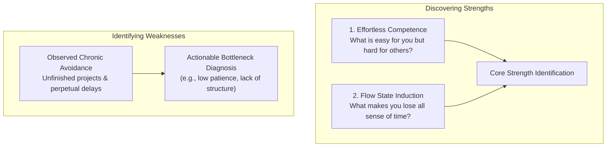

# Strengths and Weaknesses Reflection Framework

Self-awareness requires an objective, evidence-based diagnostic framework rather than abstract self-judgment. By observing empirical behavioral patterns in daily work, individuals can pinpoint their natural strengths and identify chronic operational weaknesses.

## 1. Discovering Natural Strengths

The most direct method to locate genuine intrinsic strengths is examining reality through two guiding inquiries:

### Inquiry A: Effortless Competence
> *"Is there any work you execute easily and naturally, while others struggle with it or find it grueling?"*

When a capability feels self-evident or trivial to you while requiring deliberate, exhausting effort from peers, you have identified a domain where your baseline aptitude or intuitive grasp is disproportionately high.

### Inquiry B: Time Distortion (Flow State)
> *"What activities engage you so deeply that you completely lose track of time?"*

Activities that effortlessly trigger flow states—where self-consciousness fades and focus sustains itself without severe willpower depletion—indicate intrinsic alignment with your cognitive preferences.

**The Intersection**: Tasks that satisfy both inquiries constitute your primary competitive advantage.

## 2. Diagnosing Operational Weaknesses

Weaknesses are rarely found through harsh self-criticism; they are revealed by concrete, observable behavioral evidence:
- **Chronic, Infinite Procrastination**: Look at tasks you persistently delay or abandon halfway through (such as a half-built model, neglected paperwork, or postponed maintenance).
- **Interpreting the Symptom**: An abandoned task is tangible proof of a specific behavioral bottleneck—such as low tolerance for monotony, friction with unstructured planning, or impatience with tedious procedural details.

## Strategic Application

1. **Leverage Strengths**: Direct the majority of creative and professional energy toward domains of natural competence where compounding returns are greatest.
2. **Systematize or Mitigate Weaknesses**: Rather than relying on brute willpower, apply structural frameworks (such as the ABCDE prioritization system in [[overcoming-procrastination]]) and habit frameworks (see [[five-rings-of-discipline]]) to prevent weaknesses from sabotaging progress.

## References
- Systemic task execution: [[overcoming-procrastination]]
- Mental discipline stages: [[five-rings-of-discipline]]
