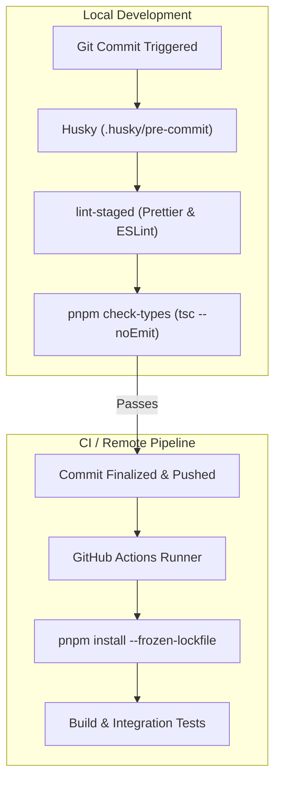

# Frontend Development Tooling: pnpm & Husky

Modern JavaScript and TypeScript engineering environments rely on specialized developer tooling to guarantee rapid dependency resolution, disk storage efficiency, and automated code hygiene. Two foundational utilities in this ecosystem are **pnpm** and **Husky**.



## 1. pnpm (Performant npm)

**pnpm** is a modern Node.js package manager designed for speed, disk-space efficiency, and monorepo workspace scalability:

- **Content-Addressable Storage**: Packages are saved once in a global content-addressable store on disk (`~/.local/share/pnpm/store`). Individual projects hard-link to these files, eliminating redundant downloads and conserving gigabytes of storage.
- **Strict Non-Flat Dependency Tree**: Unlike npm or yarn which hoist nested packages to the root `node_modules`, pnpm constructs a symlinked layout based on the project's exact dependency graph. This strictly prevents "phantom dependencies" (importing packages that are not explicitly defined in `package.json`).
- **Monorepo / Workspace Architecture**: Native support for multi-package monorepos via `pnpm-workspace.yaml` and filtering commands (e.g., `pnpm --filter`).
- **Deterministic CI Execution**: Guarantees reproducible builds in automated pipelines via `--frozen-lockfile` (see [[github-actions]]).

## 2. Husky (Git Hooks Orchestration)

**Husky** streamlines Git hooks integration for JavaScript repositories, enabling teams to enforce code formatting, linting rules, and type safety before code is committed or pushed.

### Pre-Commit Configuration
In a modern workspace, Husky executes staged-only checks using `lint-staged` along with project-wide type checking:

```bash
# .husky/pre-commit
npx lint-staged
pnpm lint
pnpm check-types
```

### The "Shift-Left" Advantage
By running linting, formatting, and TypeScript validation (`check-types`) during the local pre-commit stage:
- Developers detect syntax errors, broken imports, and stylistic violations immediately at their workstation.
- Commits pushed to remote branches remain clean, dramatically reducing pull request review cycles and avoiding failed runs in [[github-actions]].

## References
- CI/CD Automation: [[github-actions]]
- UI Component Architecture: [[react-and-tailwind-ui-patterns]]
