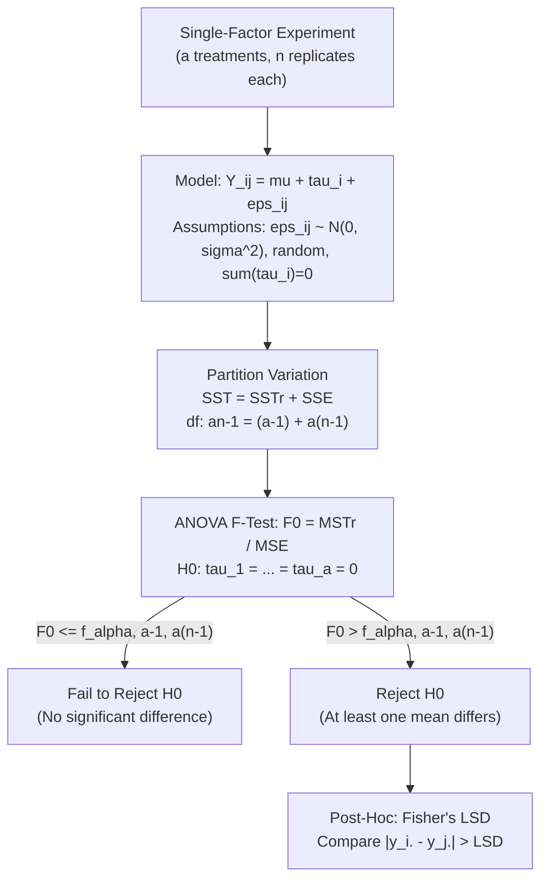

# Analysis of Variance (ANOVA) (Lecture Notes)

## TL;DR
Lecture slides by [[le-xuan-dai|Dr. Lê Xuân Đại]] (HCMUT-OISP, 2025) introducing **Single-Factor Analysis of Variance (ANOVA)** for completely randomized experiments. It covers the linear statistical model ($Y_{ij} = \mu + \tau_i + \varepsilon_{ij}$), partitioning total variation into between-group ($SS_{Tr}$) and within-group ($SS_E$) components, testing equality of treatment means via the **ANOVA $F$-test**, extending formulas to unbalanced designs, and identifying which pairs differ using **Fisher's Least Significant Difference (LSD)** method.

## Decision & Analysis Flow

## Key Sections & Worked Example

### 1. Real-World Motivation & Terminology (Examples 1.1–1.3)
- **Paper Tensile Strength Experiment**: A grocery-bag manufacturer tests **4 levels** of hardwood concentration ($5\%, 10\%, 15\%, 20\%$) with **$6$ replicates** each ($N = 24$ specimens tested in random order).
  - Group averages: $\bar{y}_{1\cdot}=10.00$, $\bar{y}_{2\cdot}=15.67$, $\bar{y}_{3\cdot}=17.00$, $\bar{y}_{4\cdot}=21.17$, overall $\bar{y}_{\cdot\cdot}=15.96$.
- **Terminology**: Each factor level is a **treatment**; each observation within a treatment is a **replicate**.

### 2. Statistical Model & Sum-of-Squares Identity
- **Model**: $Y_{ij} = \mu + \tau_i + \varepsilon_{ij} = \mu_i + \varepsilon_{ij}$, with $\varepsilon_{ij} \stackrel{\text{iid}}{\sim} N(0, \sigma^2)$ and $\sum_{i=1}^a \tau_i = 0$.
- **Partitioning**: $SS_T = SS_{Tr} + SS_E$ with degrees of freedom $an - 1 = (a-1) + a(n-1)$.
- **Expected Mean Squares (Theorems 1.1–1.2)**: $E(MSE) = \sigma^2$ always; $E(MSTr) = \sigma^2 + \frac{n\sum \tau_i^2}{a-1}$ (equals $\sigma^2$ only under $H_0$).

### 3. ANOVA $F$-Test & Unbalanced Experiments
- **Test Statistic**: $F_0 = \frac{MSTr}{MSE} \sim F_{a-1,\, a(n-1)}$ under $H_0$. Reject $H_0$ when $F_0 > f_{\alpha,\, a-1,\, a(n-1)}$.
- **Hardwood Concentration Results ($\alpha = 0.01$)**: $SS_{Tr} = 382.79$ ($df=3$, $MSTr = 127.60$), $SS_E = 130.17$ ($df=20$, $MSE = 6.51$), $f_0 = 19.60 > f_{0.01,3,20} = 4.94$ ($p = 3.59 \times 10^{-6}$). Reject $H_0$: hardwood concentration significantly affects tensile strength.
- **Unbalanced Designs**: When treatment sizes $n_i$ differ, $N = \sum_{i=1}^a n_i$ and $SS_E = SS_T - SS_{Tr}$.

### 4. Multiple Comparisons: Fisher's LSD
- After rejecting $H_0$, compare pairs $\mu_i - \mu_j$ using $t_{\alpha/2,\, a(n-1)}$ and $\text{LSD} = t_{\alpha/2,\, a(n-1)}\sqrt{\frac{2\,MSE}{n}}$.
- **Example 1.3 ($\alpha = 0.05$)**: $t_{0.025, 20} = 2.086$, $\text{LSD} = 3.07$. The 95% CI for $\mu_2 - \mu_3$ ($10\%$ vs $15\%$) is $[-4.4028,\, 1.7429]$ (includes $0$); all pairs differ significantly **except** treatments 2 and 3 ($|\bar{y}_{3\cdot} - \bar{y}_{2\cdot}| = 1.33 < 3.07$).
- See [[single-factor-anova-and-fishers-lsd]].

## Linked Knowledge
- **Concepts**: [[single-factor-anova-and-fishers-lsd]], [[f-distribution-variance-test]], [[simple-linear-regression-ols]]
- **Entities**: [[le-xuan-dai]]
