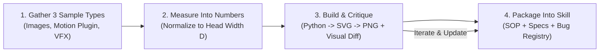

# Claude Builds 2D Animated Characters Without Drawing (Code-Driven Asset Pipeline)

## TL;DR
A creator with no drawing or coding background produced 19 animated 2D characters (each with 6 facial expressions) and two full combat scenes with VFX and SFX—without drawing a stroke or using raster AI image generators. Instead, Claude Code wrote a **Python-to-SVG-to-PNG drawing machine** calibrated from measured reference samples, animated with extracted frame-timing rules, refined through targeted visual critique, and packaged into a reusable Agent Skill. For indie game developers with weak drawing skills, this demonstrates a highly controllable way to generate consistent, modular 2D assets.

## 4-Step Pipeline Overview

## Key Takeaways & Timestamps

### 1. Gather Three Types of Reference Samples (`[00:01:34]`)
- **Static Images (`[00:01:36]`)**: 12 screenshots containing 29 characters from a favorite cartoon style (round head, cylindrical body, thick black outlines). Multiple samples let the AI separate consistent style rules from one-off details.
- **Motion Timing (`[00:01:56]`)**: An [[adobe-animate|Adobe Animate]] plugin with preset actions (shake, nod, head-shake, startle, walk) so the AI could inspect exact keyframe spacing.
- **VFX Archive (`[00:02:13]`, `[00:12:31]`)**: A compressed Animate smoke-puff effect used later for fighting scenes.
- **Core Principle (`[00:02:20]`)**: *Learn the construction rules of a style, never copy characters verbatim.*

### 2. Quantify the Style Instead of Asking for Impressions (`[00:02:40]`)
- Rather than asking for vague adjectives ("cute", "minimalist"), Claude wrote small scripts to sample skin-tone pixels, stroke thickness, and shading ratios across the 29 sample characters (~2% error margin).
- **The `D` Unit (`[00:03:11]`)**: Defined `1 D` = head width, expressing all proportions relative to `D`:
  - Total height: `2.2 D` | Torso height: `1.1 D` | Outer stroke: `0.045 D` (e.g., `9 px` on a `200 px` head).
  - Structural rules: no neck (chin rests on torso), closed cylindrical body, no legs, and 24/29 samples had no arms.
- See [[quantitative-style-measurement]] for full methodology.

### 3. Build a Code-Driven Drawing Machine + House Rules (`[00:04:01]`, `[00:05:21]`)
- Claude generated **Python scripts outputting [[svg|SVG]]**, then rendered **PNG** previews (`[00:04:12]`).
- **Modular Shared Functions (`[00:04:30]`)**: Common parts (head, torso, hands, facial expressions) live in shared functions; characters only customize hair, outfit, and props. Fixing one shared function updates all 19 characters at once.
- **Creator's House Rules (`[00:05:25]`)**:
  1. 3/4 view facing right.
  2. No arms; floating hands appear only when holding props or gesturing.
  3. No mouth by default; mouth appears small only during intense emotions.
  4. Every humanoid character has 6 expressions: neutral, happy, angry (red forehead vein), sad (tear drop), surprised, scared (3 dark-purple lines + sweat drop).

### 4. Critique Effectively: Visuals Beat Vague Prompts (`[00:06:22]`)
- **Pitfall (`[00:06:26]`)**: Asking *"can you improve the hands?"* caused the AI to add detailed, jointed fists that clashed with the minimalist style.
- **Fix (`[00:07:06]`)**: Cropping tightly around a reference hand and asking for *"simple rounded Doraemon-style hands like this"* fixed all 19 characters instantly via the shared hand function.
- **Expanding the Cast (`[00:07:53]`)**: Added historical figures (Newton, Edison, Marie Curie, Einstein, Napoleon, Tesla) using recognizable props/hairstyles with a rule: *humorous, never caricaturing physical flaws* (`[00:08:26]`).

### 5. Motion, Combat Choreography & Self-Inspection (`[00:08:50]`)
- **24 fps Motion Table (`[00:08:58]`)**: Extracted from the Animate plugin—e.g., shake = 5 stepped keyframes spaced 2 frames apart; nod = `20°` rotation held 3 frames; walk = 20-frame cycle with 2 body bounces (adapted for legless/armless characters).
- **Scene 1 — Sun Wukong vs. White Bone Spirit (`[00:09:53]`)**: 14s, 4-beat fight with Hyper Frames free SFX (`[00:10:52]`, or ElevenLabs/manual SFX).
  - *Bugs caught by human review*: Weapon occluded by hand (fixed via global `z-index` bump in shared function, `[00:11:08]`); characters teleporting back to start positions between beat 3 and beat 4 (`[00:11:30]`)—missed by automated unit checks! Added dynamic camera pan/zoom/shake (`[00:11:57]`).
- **Scene 2 — Edison vs. Tesla (`[00:12:20]`)**: 13.5s slap fight + smoke cloud brawl.
  - Claude unpacked the 30 fps smoke sample (4 main strokes, 2-frame hold, looping) and redrew it with matching black ink outlines (`[00:12:54]`).
  - *Self-inspection (`[00:14:13]`)**: Claude rendered individual impact frames and caught that impact star VFX occluded the slapping hand, fixing layer order (`body -> star -> hand -> text`).

### 6. Package Into a Reusable Skill (`[00:14:48]`)
- Bundled into a 4-part Skill (trigger description, `SKILL.md` with character + animation workflows, 3 reference docs, and code/asset library + **known-bugs & self-check registry**).
- Whenever a new mistake is fixed, feed the lesson back into the skill (`[00:17:49]`).
- See [[skill-driven-agent-workflows]] and [[code-driven-2d-asset-pipeline]].

### 7. Practical Caveats (`[00:18:22]`)
1. **High usage/quota cost**: Frequent visual critiques and re-renders consume model quota quickly.
2. **Human eye still required**: Continuity/logic bugs across cuts (e.g., character teleportation) escape automated checks.
3. **Audio licensing**: Free SFX often require attribution (export an attribution list) or manual layering for long brawls.
4. **Originality**: Measure styles you love, then adapt them into your own signature look.

## Linked Knowledge
- **Concepts**: [[code-driven-2d-asset-pipeline]], [[quantitative-style-measurement]], [[skill-driven-agent-workflows]]
- **Entities**: [[claude-code]], [[svg]], [[adobe-animate]]
