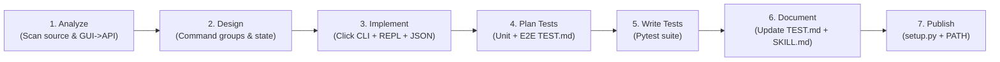

# HKUDS/CLI-Anything — Making All Software Agent-Native

## TL;DR
**CLI-Anything** (`HKUDS/CLI-Anything`, 61k+ stars, Apache-2.0) is an ecosystem and 7-phase agentic harness generator that turns GUI and desktop software into **agent-native CLIs** with structured JSON output, REPLs, undo/redo, and automated `SKILL.md` generation. It ships both **CLI-Hub** (`cli-anything-hub`) for installing 50+ pre-built software CLIs (including Obsidian, Blender, Godot, GIMP, Krita, LibreOffice, RenderDoc, Draw.io) and a **`/cli-anything`** generator plugin/skill for building new CLI harnesses from source code.

## Architecture & 7-Phase Generator



## Quick-Start & Install Commands

### Option A: Use Pre-Built CLIs (`CLI-Hub`)
```bash
pip install cli-anything-hub
cli-hub list
cli-hub search image
cli-hub install gimp
cli-hub launch gimp
```
*(Note: CLIs that wrap desktop apps still require the upstream software—e.g., GIMP, Blender, LibreOffice—to be installed.)*

### Option B: Give Antigravity / Agents the Meta-Skill
```bash
npx skills add HKUDS/CLI-Anything --skill cli-hub-meta-skill -g -y
```
*(Supports Antigravity, Claude Code, OpenClaw, Nanobot, Codex, Reasonix, Pi, Cursor.)*

### Option C: Build a New CLI Harness
- In supported agent plugins: `/cli-anything <software-path-or-repo>` (plus `/cli-anything:refine <path> [focus]` for iterative gap-filling).

## Tech Stack & Requirements
- **Language & Core Deps**: Python `>= 3.10`, `click >= 8.0`, `pytest` (unit + E2E coverage), `defusedxml` for XML/SVG parsing.
- **License**: Apache-2.0 (`arXiv:2606.03854`).
- **Windows Caveat**: Plugin scripts expecting POSIX `bash` / `cygpath` require Git for Windows or WSL when run via Claude Code.

## Linked Knowledge
- **Entities**: [[cli-anything]], [[claude-code]]
- **Concepts**: [[skill-driven-agent-workflows]]
