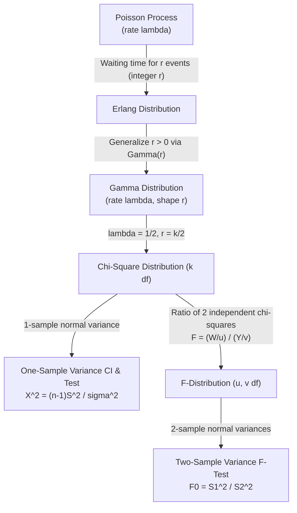

# Inference on the Variances (Lecture Notes)

## TL;DR
Lecture slides by [[le-xuan-dai|Dr. Lê Xuân Đại]] (HCMUT-OISP, 2025) covering statistical inference for population variances under normality assumptions. The lecture builds from the Poisson waiting-time foundations (**Erlang** and **Gamma distributions**) to the **Chi-Square ($\chi^2$) distribution** for one-sample variance confidence intervals and hypothesis tests, and concludes with the **$F$-distribution** for comparing two independent population variances.

## Conceptual Hierarchy

## Key Sections & Formulas

### 1. Erlang and Gamma Distributions
- **Erlang**: Waiting time $X$ until the $r$-th event in a Poisson process with rate $\lambda$:
  $$P(X > x) = \sum_{k=0}^{r-1} \frac{e^{-\lambda x}(\lambda x)^k}{k!}, \qquad f(x) = \frac{\lambda^r x^{r-1} e^{-\lambda x}}{(r-1)!} \quad (x > 0)$$
- **Gamma Function**: $\Gamma(r) = \int_0^\infty x^{r-1} e^{-x}\,dx$ ($r>0$), with $\Gamma(r) = (r-1)\Gamma(r-1)$, $\Gamma(1)=1$, and $\Gamma(1/2)=\sqrt{\pi}$.
- **Gamma Distribution**: Generalizes Erlang to any $r > 0$ (shape) and $\lambda > 0$ (rate), with $\mu = r/\lambda$ and $\sigma^2 = r/\lambda^2$.
- **Examples**: CPU failure waiting time (Ex 1.1: $\lambda = 0.0001$, $r=4$, $P(X > 40000) \approx 0.433$); genome-slicing class prep time (Ex 1.2: $\lambda = 0.5$, $r=10$, $P(X > 25) \approx 0.2014$, $E(X)=20$, $\text{SD} \approx 6.32$ hours).
- See [[gamma-and-erlang-distributions]].

### 2. One-Sample Variance Test & Confidence Intervals
- **Chi-Square Link**: Special case of Gamma with $\lambda = 1/2$ and $r = k/2$ ($k \in \mathbb{N}$ degrees of freedom).
- **Sampling Theorem (Theorem 2.1)**: For a random sample of size $n$ from $N(\mu, \sigma^2)$,
  $$X^2 = \frac{(n-1)S^2}{\sigma^2} \sim \chi^2_{n-1}$$
- **Confidence Intervals**:
  - Two-sided $100(1-\alpha)\%$: $\left[\frac{(n-1)s^2}{\chi^2_{\alpha/2,\, n-1}},\; \frac{(n-1)s^2}{\chi^2_{1-\alpha/2,\, n-1}}\right]$
  - One-sided bounds: $\sigma^2 \ge \frac{(n-1)s^2}{\chi^2_{\alpha,\, n-1}}$ (lower) and $\sigma^2 \le \frac{(n-1)s^2}{\chi^2_{1-\alpha,\, n-1}}$ (upper).
- **Hypothesis Test ($H_0: \sigma^2 = \sigma_0^2$)**: Test statistic $\chi_0^2 = \frac{(n-1)s^2}{\sigma_0^2}$.
  - Ex 2.1 & 2.2 (bottle-filling variance, $n=20, s^2=0.0153$): 95% upper bound $\sigma^2 \le 0.0287$ ($\sigma \le 0.1695$); testing $H_1: \sigma^2 > 0.01$ gives $\chi_0^2 = 29.07 < \chi^2_{0.05, 19} = 30.14$ (fail to reject $H_0$).
- See [[chi-square-variance-inference]].

### 3. Two-Sample Variance Test ($F$-Distribution)
- **Definition**: If $W \sim \chi^2_u$ and $Y \sim \chi^2_v$ are independent, $F = \frac{W/u}{Y/v} \sim F_{u, v}$.
- **Moments & Quantiles**: $\mu = \frac{v}{v-2}$ ($v>2$), $\sigma^2 = \frac{2v^2(u+v-2)}{u(v-2)^2(v-4)}$ ($v>4$), and $f_{1-\alpha, u, v} = \frac{1}{f_{\alpha, v, u}}$.
- **Hypothesis Test ($H_0: \sigma_1^2 = \sigma_2^2$)**: For independent normal samples, $F_0 = \frac{S_1^2}{S_2^2} \sim F_{n_1-1,\, n_2-1}$ under $H_0$.
  - Ex 3.1 (semiconductor wafer etching, $n_1=n_2=16, s_1=1.96, s_2=2.13$): $f_0 = 0.8467$, inside $[0.35, 2.86]$ at $\alpha = 0.05$ (fail to reject $H_0$).
- See [[f-distribution-variance-test]].

## Linked Knowledge
- **Concepts**: [[gamma-and-erlang-distributions]], [[chi-square-variance-inference]], [[f-distribution-variance-test]]
- **Entities**: [[le-xuan-dai]]
