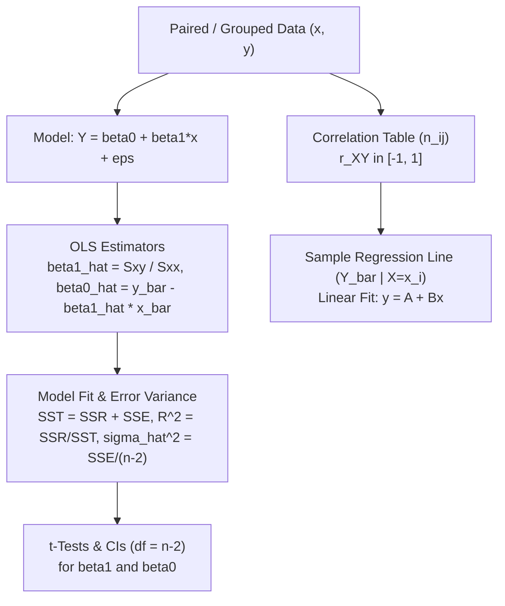

# Simple Linear Regression and Correlation (Lecture Notes)

## TL;DR
Lecture slides by [[le-xuan-dai|Dr. Lê Xuân Đại]] (HCMUT-OISP, 2025) introducing empirical modeling of non-deterministic relationships between two variables. It covers **Simple Linear Regression** via Ordinary Least Squares (OLS), variance decomposition ($SS_T = SS_E + SS_R$) and $R^2$, $t_{n-2}$ inference for slope and intercept, the **Sample Correlation Coefficient ($r_{XY}$)** from grouped correlation tables, and the **Sample Regression Line** ($\bar{Y}_{x_i}$ and its linear fit $y = A + Bx$).

## Workflow Overview

## Key Sections & Worked Examples

### 1. Empirical Models
- **Deterministic vs. Non-Deterministic**: Deterministic models (e.g., $d_t = d_0 + vt$) predict outcomes exactly; real-world engineering relationships (house electricity vs. size, fuel vs. weight, oxygen purity vs. hydrocarbon level) include random variation:
  $$Y = \beta_0 + \beta_1 x + \varepsilon, \qquad E(Y|x) = \beta_0 + \beta_1 x, \qquad V(Y|x) = \sigma^2$$

### 2. Simple Linear Regression (OLS)
- **Normal Equations & Estimates**: Minimizing $L = \sum_{i=1}^n (y_i - \beta_0 - \beta_1 x_i)^2$ yields $\hat{\beta}_1 = S_{xy}/S_{xx}$ and $\hat{\beta}_0 = \bar{y} - \hat{\beta}_1 \bar{x}$.
- **Example 2.1 & 2.2 (Oxygen Purity, $n=20$)**: $S_{xx} = 0.68088$, $S_{xy} = 10.17744 \implies \hat{y} = 74.283 + 14.947x$, and unbiased error variance $\hat{\sigma}^2 = \frac{SS_E}{n-2} \approx 1.1805$.
- **Variation & $R^2$**: $SS_T = SS_E + SS_R$, with coefficient of determination $R^2 = SS_R / SS_T \in [0, 1]$.
- **Inference ($\varepsilon \sim N(0, \sigma^2)$)**: Both $\hat{\beta}_0, \hat{\beta}_1$ are normal; hypothesis tests and $100(1-\alpha)\%$ CIs use $T_0 \sim t_{n-2}$ with standard errors $\text{SE}(\hat{\beta}_1) = \sqrt{\hat{\sigma}^2 / S_{xx}}$ and $\text{SE}(\hat{\beta}_0) = \sqrt{\left(\frac{1}{n} + \frac{\bar{x}^2}{S_{xx}}\right)\hat{\sigma}^2}$.
- See [[simple-linear-regression-ols]].

### 3. Sample Correlation Coefficient ($r_{XY}$)
- From a bivariate frequency table ($n_{ij}$), $r_{XY} = \frac{\overline{xy} - \bar{x}\bar{y}}{\hat{s}_X \hat{s}_Y} \in [-1, 1]$ measures linear association ($0$ = no linear relationship, $\pm 1$ = exact linear).
- **Example 3.1 (Investment $X$ vs. Profit $Y$, $n=100$)**: $\bar{x}=2$, $\hat{s}_X^2=0.6$, $\bar{y}=0.71$, $\hat{s}_Y^2=0.0589$, $\overline{xy}=1.56 \implies r_{XY} = 0.7447$.
- Includes Casio `STAT -> A+BX` calculator steps.

### 4. Sample Regression Line
- Plots conditional sample means $\bar{Y}_{x_i} = \frac{1}{n_i}\sum_{j=1}^h n_{ij} y_j$ as a piecewise linear curve, then fits the closest straight line $y = A + Bx$ minimizing $Q(A, B) = \sum_{i=1}^k n_i[\bar{Y}_{x_i} - (A + Bx_i)]^2$.
- **Math ($X$) vs. Literature ($Y$) Scores ($n=100$)**: $y = 1.02 + 0.98x$ ($r_{XY} = 0.85015$), predicting $Y \approx 9.82$ when $X=9$.
- See [[sample-correlation-and-regression-line]].

## Linked Knowledge
- **Concepts**: [[simple-linear-regression-ols]], [[sample-correlation-and-regression-line]]
- **Entities**: [[le-xuan-dai]]
