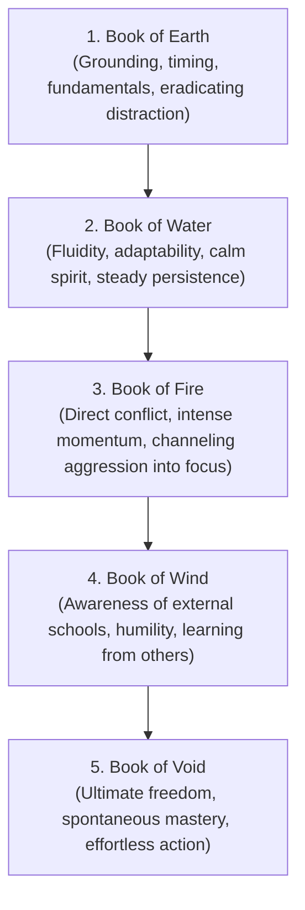

# The Complete Book of Five Rings (Miyamoto Musashi)

## Overview
- **Author**: Miyamoto Musashi (c. 1584–1645)
- **Original Title**: *Go Rin No Sho* (五輪書)
- **Primary Domain**: Martial Arts (Kenjutsu / Niten Ichi-ryū), Military Strategy, and Philosophy of Mastery
- **Digital Reference**: [The Complete Book of Five Rings on OverDrive](https://www.overdrive.com/media/604947/the-complete-book-of-five-rings)

## Core Philosophy: Strategy as a Way of Life

Composed near the end of Musashi's life in the Reigandō cave, *The Book of Five Rings* synthesizes decades of undefeated combat into a comprehensive philosophical doctrine. Musashi emphasizes that the "Way" (Do) is universal: principles governing single combat extend directly to managing armies, crafts, governance, and self-mastery.

True discipline, according to Musashi, is neither an artificial imposition nor a temporary technique used to make life easy; it is the total integration of virtue, relentless practice, and calm awareness into one's fundamental character.

## The Five Elemental Scrolls

1. **The Book of Earth (*Chi no Maki*)**:
   - Lays the bedrock foundation. Establishes the necessity of knowing the craft, understanding timing, and recognizing reality clearly without self-deception.
2. **The Book of Water (*Sui no Maki*)**:
   - Represents flexibility and spirit. Water shapes itself to any vessel, yet erodes solid stone through continuous, patient flow. Demands a calm, unshakeable mind in the midst of turmoil.
3. **The Book of Fire (*Ka no Maki*)**:
   - Focuses on confrontation, decisive action, and momentum. Channels competitive tension and friction into uncompromising drive.
4. **The Book of Wind (*Fū no Maki*)**:
   - Analyzes other traditions and schools. Demands profound humility: by examining the methods and weaknesses of others, one avoids dogmatic stagnation and refines one's own path.
5. **The Book of Void (*Kū no Maki*)**:
   - The culminating scroll addressing the Void—the state of no-mind (*mushin*). Action emerges naturally and spontaneously without conscious strain or contrivance, where discipline and identity are identical.

## Linked Conceptual Synthesis
- Derived Framework: [[five-rings-of-discipline]]
